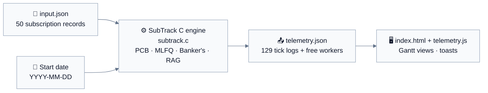
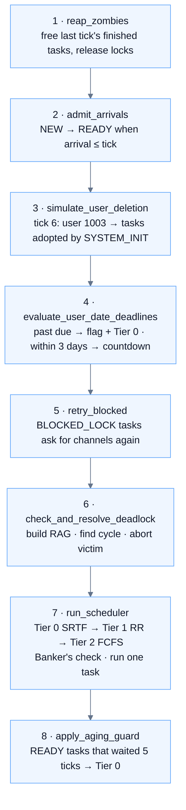
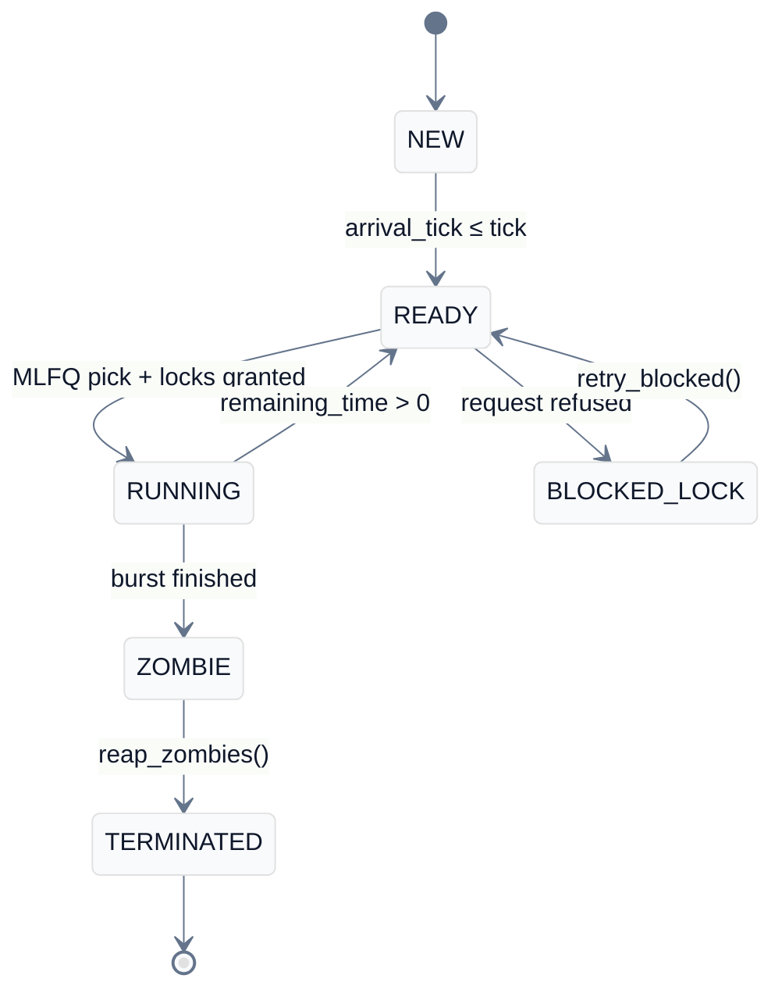
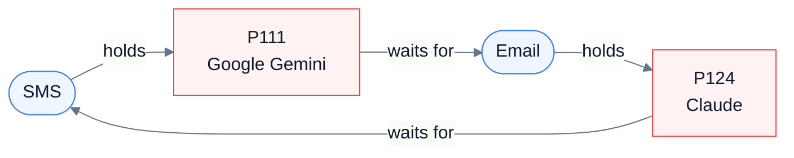
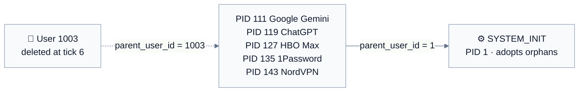
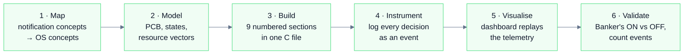

<div align="center">


# 🔔 SubTrack

### An OS-Driven Subscription Tracking & Notification Engine

*Every subscription notification is a process. Every delivery channel is a lock. One tick is one calendar day.*


-0-16A34A?style=for-the-badge)


| 50 | 3 | 3 | 129 | 0 |
|:---:|:---:|:---:|:---:|:---:|
| **processes** | **MLFQ tiers** | **worker locks** | **ticks simulated** | **deadlocks** |

[Core Idea](#-the-core-idea) · [Problem](#-problem-statement) · [Objectives](#-objectives) · [Motivation](#-motivation) · [System](#-system-overview) · [Techniques](#-techniques-algorithms--tech-stack) · [Methodology](#-methodology--approach) · [Results](#-results--outcomes) · [Get Started](#-getting-started) · [Roadmap](#-future-roadmap) · [References](#-references)

</div>

---

## 💡 The Core Idea

> **The Problem:** A subscription platform produces a constant stream of notifications (payment failures, security alerts, renewal reminders, usage digests) but can only push them through a handful of limited delivery channels: SMS gateways, mail workers and webhook endpoints. A failed payment must never sit behind a weekly digest, and a digest must never wait forever.
>
> **The Solution:** This is exactly the problem an operating system solves when many processes compete for one CPU and a few shared resources. SubTrack models each notification as a **process** with a Process Control Block, each channel as a **lock-protected resource**, and lets classic OS machinery (a Multi-Level Feedback Queue, aging, the Banker's algorithm, Resource Allocation Graph detection, orphan adoption and zombie reaping) decide what is sent, when, and in what order.

Seeing a *"Payment failed"* alert for a Netflix subscription jump the queue is far easier to reason about than a table of `P1 … P5`. That is the point of the project.

---

## 🎯 Problem Statement

**Design and implement a deterministic discrete-event simulation of a subscription notification system** in which notification tasks of different urgency and duration compete for **one dispatcher** and **three finite worker channels**, such that the system satisfies four requirements at the same time:

| # | Requirement | What it means concretely |
|:-:|---|---|
| **A** | **Urgent first, nobody starved** | Payment failures and security alerts must pre-empt routine work, yet low-priority digests must still eventually be delivered. |
| **B** | **Calendar-date deadlines** | Every subscription has an end date. The engine must compare it with *today* on every tick, warn before it, and escalate after it. |
| **C** | **Deadlock-free resource sharing** | Tasks hold some channels while waiting for others (hold-and-wait) and request them in different orders. Sharing SMS (4), Email (4) and Webhook (3) workers must never deadlock. |
| **D** | **Correct lifecycle handling** | Tasks whose owner is deleted must not be lost (orphans), and tasks that have finished but are not yet acknowledged must be cleaned up and their locks released (zombies). |

**Why this is hard.** The four requirements pull against one another. Strict priority (A) causes starvation, so it needs aging. Escalating overdue tasks (B) floods the top tier and creates contention for the same three channels. Contention plus hold-and-wait (C) is the textbook recipe for deadlock. Cleaning up correctly (D) matters because a leaked lock silently shrinks the worker pool for everyone. A solution has to satisfy all four *simultaneously*, be **observable** (every decision logged), and be **reproducible** (same input and start date, same output).

**Inputs.** A set of 50 subscription records (`input.json`) and a simulation start date.
**Outputs.** A machine-readable per-tick event log (`telemetry.json`) and a browser dashboard that replays it.

---

## 🧭 Objectives

1. **Model notifications as processes.** Represent every subscription notification as a process with a full Process Control Block (`SubscriptionPCB`) and a six-state lifecycle.
2. **Schedule by urgency without starvation.** Implement a 3-tier MLFQ (Tier 0 SRTF for urgent alerts, Tier 1 Round-Robin for renewals, Tier 2 FCFS for digests) with an aging guard, and escalate tasks past their calendar deadline using date-wise evaluation.
3. **Share limited channels safely.** Model SMS, Email and Webhook workers as mutual-exclusion resources and guarantee deadlock avoidance with the Banker's algorithm.
4. **Detect and recover from deadlock.** Provide a Resource Allocation Graph with DFS cycle detection and victim-based recovery for when avoidance is switched off (`--unsafe`), and demonstrate orphan re-parenting and zombie reaping.
5. **Make every decision visible.** Produce a machine-readable telemetry log and an interactive dashboard with four Gantt views and live toast notifications.

---

## 🔥 Motivation

<table>
<tr>
<td width="50%" valign="top">

### 📚 Learning Potential
Building SubTrack forces hands-on use of concrete engineering concepts:

- **Data structures:** fixed-size PCB arrays, a `Sim` context struct passed by pointer, adjacency-style graph for the RAG, vectors for `max_need`, `allocated` and `available`.
- **Algorithms:** SRTF, Round-Robin, FCFS, aging, the Banker's safety algorithm, DFS cycle detection with three-colour visit states.
- **Design patterns:** a single-tick state machine, event sourcing (every action becomes a log event), and a deterministic simulation core separated from its presentation layer.
- **Optimisation:** converting dates to epoch-day integers so deadline logic is a subtraction, and trial-allocate-then-undo for safe grants.
- **Systems skills:** writing a dependency-free JSON parser and emitter in C.

</td>
<td width="50%" valign="top">

### 🌍 Real-World Relation
People hold dozens of recurring subscriptions across cloud, developer, streaming and productivity services, and each one emits alerts of very different urgency. Notification platforms really do have limited sender capacity (SMS gateways, mail workers, webhook endpoints, API rate limits) and must decide what goes first. Operating systems already contain tested answers to exactly this: scheduling, synchronisation, deadlock handling and lifecycle management. The friction is observable in daily life: a critical *"payment failed"* mail buried among marketing digests.

</td>
</tr>
<tr>
<td width="50%" valign="top">

### 🧑‍💻 User Feasibility
- Builds with **one command** (`gcc`), no package manager, no external libraries.
- Runs on **Windows (MinGW or WSL) and Linux**.
- The dashboard opens by **double-click** (`telemetry.js` mirrors the JSON), and also works through `fetch` or manual file pick.
- Behaviour is tunable through `#define` constants, so a student can experiment in seconds.
- The same engine is useful to *learners* (a teaching tool) and as a *starting model* for rate-limited messaging gateways.

</td>
<td width="50%" valign="top">

### 🔋 Sustainability
The project stays interesting when debugging gets tough because the bugs are *visible*. A lock leak shows up as a worker bar that never refills; a missed promotion shows up as a flat Gantt row; a deadlock shows up as a named cycle in the log. Each new OS concept plugs into the same scenario and the same dashboard, so there is always a next, concrete thing to add (EDF ordering, demotion, multi-core) without starting over.

</td>
</tr>
</table>

---

## 🗂️ System Overview

### 🎨 UI & Experience Design

- **Design philosophy:** clean, light, high-legibility layout (white surface, slate text, IBM Plex fonts) built with Tailwind CSS. Colour carries meaning: *tier* colours in the Gantt views, *severity* colours in the toasts.
- **Zero-friction loading:** three ways to load data: `telemetry.js` (double-click), `fetch(telemetry.json, input.json)`, or the *Open telemetry.json and input.json* file picker.

| Dashboard panel | What it shows |
|---|---|
| **Controls** | Reset · Back · Play · Step · tick slider · speed *Slow 4.5 s / Normal 2.5 s / Fast 1 s* per tick |
| **Live state** | 8 stat tiles, free-worker bars, 4 Gantt tabs, subscription list with live status |
| **History** | Events of the current tick plus a full event log with colour filter chips |
| **Toasts** | Floating notifications, four severity colours, sorted red → amber → green → blue |

<details>
<summary><b>🔔 The four toast colours (click to expand)</b></summary>

<br>

| Colour | Label | Events |
|:-:|---|---|
| 🟢 Success | **DISPATCH CONFIRMED** | `CPU_EXECUTE`, `TASK_COMPLETED` |
| 🟠 Warning | **STATE ESCALATION** | `AGING_PROMOTION`, `ORPHAN_REPARENTED`, `RATE_LIMIT_BLOCKED` |
| 🔴 Critical | **DEADLINE EXCEEDED** | `DEADLINE_ENDED`, `DEADLINE_BREACH`, `RAG_DEADLOCK_DETECTED`, `DEADLOCK_PREEMPTION` |
| 🔵 Info | **SYSTEM TELEMETRY** | `DEADLINE_COUNTDOWN`, `USER_DELETED`, `ZOMBIE_REAPED` |

The first 3 events of a tick become toasts; the rest collapse into *"+N more events this tick"*. Toast lifetime is `max(2.2 s, speed − 0.5 s)` while playing, and 5 s when stepping.

</details>

### 🗄️ Data Model & Schema

SubTrack has no database server. Persistence is **file-based and event-sourced**: a JSON input, an in-memory PCB table, and an append-only per-tick JSON log.

<details open>
<summary><b>📥 Input record (<code>input.json</code>, 50 records, 8 users)</b></summary>

```json
{"pid": 101, "user_id": 1001, "service": "AWS", "plan": "Developer Support",
 "price": "$29.00/mo", "alert": "Renewal reminder", "burst_time": 3,
 "arrival": 1, "tier": 1, "deadline": "2026-10-12", "max_need": [1, 1, 0]}
```

| Field | Meaning |
|---|---|
| `pid` | Unique process id (**`1` is reserved** for `SYSTEM_INIT`) |
| `user_id` | Owning account (the *parent* in the lifecycle model) |
| `burst_time`, `arrival` | CPU ticks required, and the tick at which the task is admitted |
| `tier` | `0` payment failures & security alerts · `1` renewal reminders · `2` background digests |
| `deadline` | Subscription end date, `YYYY-MM-DD` |
| `max_need` | Workers needed on `[SMS, Email, Webhook]` (capacity `4, 4, 3`) |
| `plan`, `price`, `alert` | Dashboard display only |

The loader validates: `pid > 1`, `burst ≥ 1`, `arrival ≥ 1`, tier in `0…2`, valid date (year ≥ 1970), `max_need` within channel capacity, no duplicate `pid`, and at most `MAX_PROCESSES = 50` records.

</details>

<details>
<summary><b>🧱 In-memory PCB (<code>SubscriptionPCB</code>)</b></summary>

```c
typedef struct {
    int  pid;
    int  user_id;
    int  parent_user_id;           /* becomes SYSTEM_INIT_PID after user deletion */
    char service[SERVICE_LEN];
    State state;

    int  tier;                     /* 0 = SRTF, 1 = Round-Robin, 2 = FCFS */
    int  arrival_tick;
    int  burst_time;
    int  remaining_time;
    int  wait_time;                /* ticks spent READY without running (aging) */
    int  quantum_used;             /* ticks used in the current Round-Robin slice */
    int  last_run_tick;

    char deadline_date[DATE_LEN];  /* YYYY-MM-DD */
    int  deadline_epoch_days;
    int  is_flagged_exceeded;
    int  aborted;                  /* killed by deadlock resolution */

    int  max_need[NUM_RESOURCES];  /* worker channels needed to run */
    int  allocated[NUM_RESOURCES]; /* worker channels held right now */
} SubscriptionPCB;
```

| Field group | Fields |
|---|---|
| Identity | `pid`, `user_id`, `parent_user_id`, `service` |
| Scheduling | `state`, `tier`, `arrival_tick`, `burst_time`, `remaining_time`, `wait_time`, `quantum_used`, `last_run_tick` |
| Deadline | `deadline_date`, `deadline_epoch_days`, `is_flagged_exceeded`, `aborted` |
| Resources | `max_need[3]`, `allocated[3]` for SMS, Email, Webhook |

</details>

<details>
<summary><b>📤 Telemetry tick object (<code>telemetry.json</code>, one per tick)</b></summary>

Abridged from the real tick 2:

```json
{ "tick": 2, "current_date": "2026-10-11",
  "logs": [
    {"event":"DEADLINE_COUNTDOWN","pid":103,"deadline":"2026-10-11","days_remaining":0},
    {"event":"DEADLINE_ENDED","pid":104, "...": "..."},
    {"event":"CPU_EXECUTE","pid":103,"remaining_ticks":1,"flagged":"false"},
    {"event":"TASK_COMPLETED","pid":103, "...": "..."},
    {"event":"TICK_END"} ],
  "workers": {"SMS":1,"Email":1,"Webhook":0} }
```

`workers` = **free** channels at the end of the tick. The shipped run emits **11 event types**; `--unsafe` adds `RAG_DEADLOCK_DETECTED` and `DEADLOCK_PREEMPTION` for **13**.

</details>

**Relationships.** `user_id` → many `pid`s (one-to-many). Deleting a user re-points `parent_user_id` of their live tasks to `1` (`SYSTEM_INIT`) rather than cascading a delete. Each PCB holds up to three `allocated[]` counters against a shared `available[]` pool.

### 🔄 System Workflow



**Inside the engine, one tick = one CPU time unit = one calendar day**, executed in this fixed order:



| Stage | Plain-language description |
|---|---|
| **Ingestion** | `input.json` is parsed into fixed-size PCB arrays; tasks wait in `NEW` until their arrival tick. |
| **Processing** | The tick loop evaluates deadlines, resolves deadlocks, picks one task, acquires its channels through the Banker's gate, and runs it for one tick. |
| **Persistence** | Every action is appended to `telemetry.json` as a typed event; `telemetry.js` is written as a copy. |
| **Reflection** | The dashboard replays the log tick by tick, drawing Gantt rows, worker bars and toasts. |

---

## 🛠️ Techniques, Algorithms & Tech Stack

### 🧩 Concept-to-Code Map

Ten operating-system ideas mapped onto the subscription domain:

| # | OS concept | SubTrack mapping | Where in `subtrack.c` |
|:-:|---|---|---|
| 1 | PCB | Subscription control block | `SubscriptionPCB` |
| 2 | CPU burst | Notification processing time | `burst_time`, `remaining_time` |
| 3 | MLFQ | Urgency tiers | `pick_tier0/1/2`, `pick_next` |
| 4 | Aging guard | Starvation prevention | `apply_aging_guard()` |
| 5 | Real-time deadlines | Date-wise cancellation limit and flagging | `evaluate_user_date_deadlines()` |
| 6 | Mutex / locks | API worker-pool channels | `available[]`, `total[]` |
| 7 | Banker's algorithm | Rate-limit gatekeeper | `request_resources()`, `is_safe()` |
| 8 | RAG cycle detector | Deadlock resolver | `build_graph`, `dfs`, `check_and_resolve_deadlock()` |
| 9 | Orphan re-parenting | Deleted-user task adoption | `simulate_user_deletion()` |
| 10 | Zombie reaping | Completed-task cleanup | `reap_zombies()` |

### 🔬 Technical Depth

<details open>
<summary><b>1 · Process lifecycle (state machine)</b></summary>



</details>

<details>
<summary><b>2 · Multi-Level Feedback Queue</b></summary>

`pick_next()` always serves the **lowest-numbered tier that has a READY task**.

| Tier | Policy | Serves | Rule | In the shipped run |
|:-:|---|---|---|---|
| **0** | **SRTF** (Shortest Remaining Time First) | Payment failures, security alerts, overdue and aged tasks | Smallest `remaining_time` | 10 tasks start here · served **108** CPU ticks |
| **1** | **Round-Robin**, `TIME_QUANTUM = 2` | Renewal reminders | Same task while `quantum_used < 2`, else longest-waiting | 25 tasks start here · served **20** CPU ticks |
| **2** | **FCFS** | Background digests, usage summaries, price notices | Smallest `arrival_tick` | 15 tasks start here · served **0** CPU ticks (all 15 aged into Tier 0 first) |

```c
static int pick_next(Sim *s) {
    int i = pick_tier0(s);            /* SRTF */
    if (i < 0) i = pick_tier1(s);     /* Round-Robin, quantum = 2 */
    if (i < 0) i = pick_tier2(s);     /* FCFS */
    return i;
}
```

</details>

<details>
<summary><b>3 · Aging guard (starvation prevention)</b></summary>

A `READY` task in Tier 1 or 2 that goes **5 ticks without running** is promoted to Tier 0. Only `READY` tasks age; `BLOCKED_LOCK` tasks do not, and tasks already in Tier 0 are skipped.

```c
void apply_aging_guard(Sim *s, int ran_index) {
    for (int i = 0; i < s->count; i++) {
        SubscriptionPCB *p = &s->pcb[i];
        if (i == ran_index || p->state != STATE_READY || p->tier == 0) continue;
        p->wait_time++;
        if (p->wait_time >= AGING_THRESHOLD) {      /* 5 */
            log_event(s, "AGING_PROMOTION", p, "...");
            p->tier = 0;
            p->wait_time = 0;
        }
    }
}
```

**Data:** 29 promotions (15 from Tier 2, 14 from Tier 1). First promotion at tick 6 (Replit, PID 105). Ticks 7 to 13 promote Figma, Tidal, Evernote, Peacock, Postman, Hulu and HBO Max.

</details>

<details>
<summary><b>4 · Date-wise deadline evaluation</b></summary>

Dates become *days since 1970-01-01*, so deadline arithmetic is one subtraction:

```c
int date_to_days(const char *iso) {
    ...
    for (int yr = 1970; yr < y; yr++) days += is_leap(yr) ? 366 : 365;
    for (int mo = 1; mo < m; mo++)    days += days_in_month(y, mo);
    return days + d - 1;
}
```

Every tick, for every live task: `days_remaining = deadline_epoch_days − today`.

| Condition | Action | Event |
|---|---|---|
| `days_remaining < 0` (first time) | `is_flagged_exceeded = 1`, `tier = 0` | `DEADLINE_ENDED` |
| `0 ≤ days_remaining ≤ 3` (`COUNTDOWN_DAYS`) | Warn | `DEADLINE_COUNTDOWN` |
| Task completes after its deadline | Record days late | `DEADLINE_BREACH` |

*Example:* GitHub Copilot (PID 104, deadline 2026-10-04) is flagged at tick 2 (2026-10-11) with `days_remaining = −7`, promoted to Tier 0, and finishes at tick 11, 16 days past its deadline.

</details>

<details>
<summary><b>5 · Locks, request ordering and hold-and-wait</b></summary>

Workers are fixed-capacity resources: **R0 SMS = 4, R1 Email = 4, R2 Webhook = 3**. A task cannot run until it holds *every* channel in `max_need`. Channels are acquired **one type at a time, in a pid-dependent order** (`channel_at(p, k) = (pid + k) % 3`), so different tasks request in different orders, as real services do:

| `pid % 3` | Request order |
|:-:|---|
| 0 | SMS → Email → Webhook |
| 1 | Email → Webhook → SMS |
| 2 | Webhook → SMS → Email *(e.g. PID 101)* |

A refused task **keeps whatever it already holds**. That is deliberate hold-and-wait: it is what makes circular wait possible once the Banker's check is turned off. Locks return to the pool through `release_resources()`, called by `reap_zombies()` and by deadlock-victim abort.

*Real tick 3:* GitHub Copilot (`max_need [4,3,2]`) is granted 2 Webhook workers, is refused SMS, and keeps them while blocked (Webhook shows 1 of 3 free).

</details>

<details>
<summary><b>6 · Banker's algorithm (deadlock avoidance)</b></summary>

For each channel `r`, `request_resources(p)` does:

1. `need = max_need[r] − allocated[r]`; skip if `0`.
2. `need > available[r]` → refuse: *not enough free workers*.
3. With Banker's **ON**: pretend to grant, run `is_safe()`, undo (`grant_is_safe`).
4. Unsafe → refuse: *"Banker's check: grant would be unsafe"*.
5. Any refusal → `BLOCKED_LOCK` + `RATE_LIMIT_BLOCKED`. Blocked tasks retry every tick.

```c
static int is_safe(Sim *s) {
    int work[NUM_RESOURCES];
    memcpy(work, s->available, sizeof work);
    /* repeatedly find a live task whose remaining need <= work,
       let it finish, add its allocation back to work */
    ...
    /* safe only if every live task could finish */
}
```

The safety pass is `O(n² · m)` with `n ≤ 50` tasks and `m = 3` resource types, which is negligible per tick.

</details>

<details>
<summary><b>7 · Resource Allocation Graph (deadlock detection & recovery)</b></summary>

With `--unsafe`, the Banker's check is disabled. `check_and_resolve_deadlock()` then:

1. **Guard:** do nothing if a `READY` task that holds locks could still finish (it is not a real deadlock).
2. **Build** the graph: nodes = processes + 3 channels. Edge *process → channel* = waiting; *channel → process* = holding.
3. **DFS** with visit states `0 / 1 / 2`; an edge back to a node on the current path is a cycle.
4. **Victim:** lowest priority in the cycle (highest tier number, then highest PID). `release_resources()`, `state = TERMINATED`, `aborted = 1`.

**Real cycle**, `./subtrack --unsafe`, tick 19 (2026-10-28):



```text
RAG_DEADLOCK_DETECTED  cycle: SMS -> P111 -> Email -> P124 -> SMS
DEADLOCK_PREEMPTION    PID 124 Claude aborted, locks released
```

</details>

<details>
<summary><b>8 · Orphans & zombies (process lifecycle)</b></summary>

**Orphans.** `DELETE_USER = 1003` at `DELETE_TICK = 6`. Every task of that user that is not `ZOMBIE` / `TERMINATED` gets `parent_user_id: 1003 → 1`. Events: 5 × `ORPHAN_REPARENTED`, then `USER_DELETED` with `children: 5`. Adopted tasks are **not** killed; all 5 still complete.



**Zombies.** A finished task becomes a `ZOMBIE`: done, but still holding its locks while the delivery ACK is pending. It is reaped as the **first step of the next tick**:

```c
void reap_zombies(Sim *s) {
    for (int i = 0; i < s->count; i++) {
        SubscriptionPCB *p = &s->pcb[i];
        if (p->state != STATE_ZOMBIE) continue;

        release_resources(s, p);
        p->state = STATE_TERMINATED;
        log_event(s, "ZOMBIE_REAPED", p, "...");
    }
}
```

*Real trace, iCloud+ (PID 103), holds `[2,2,3]`:* tick 2 → `CPU_EXECUTE` → `TASK_COMPLETED` → `ZOMBIE`; tick 3 → `ZOMBIE_REAPED` (*"Delivery ACK received, locks released, PCB freed"*). Across the run, **50 `TASK_COMPLETED` = 50 `ZOMBIE_REAPED`**.

</details>

### 📦 Tech Stack & Ecosystem

| Layer | Technologies Used |
|---|---|
| **Backend & Core Engine** | C (C99) • `gcc` • hand-written JSON parser and emitter (no external library) |
| **Frontend & UI** | HTML5 • Tailwind CSS • Vanilla JavaScript (ES6) • IBM Plex fonts |
| **Data & Persistence** | `input.json` (in) • `telemetry.json` + `telemetry.js` (out), file-based and event-sourced |
| **Platform** | Windows (MinGW or WSL) • Linux |

<div align="center">

<table>
<tr>
<td></td>
<td></td>
</tr>
<tr>
<td></td>
<td></td>
</tr>
</table>

</div>

**Tech stack improvement.** The project deliberately pushes past a typical coursework build: a dependency-free JSON parser written in C (`read_file`, `find_value`, `read_int / read_string / read_triple`, `parse_record`), a simulation core cleanly decoupled from its UI through a file contract, and a dashboard that renders four chart types directly from the event log with no charting library.

---

## 🧪 Methodology & Approach



**Notification → OS mapping**

| Subscription system | OS concept |
|---|---|
| Notification task | Process, stored in `SubscriptionPCB` |
| Dispatcher | CPU (one task per tick) |
| SMS, Email, Webhook workers | Resources R0, R1, R2 (capacity 4, 4, 3) |
| Tier of the alert | MLFQ queue level |
| Subscription end date | Deadline |
| Deleted user account | Parent-process termination, which creates orphans |
| Delivery ACK pending | Zombie process |

**Design decisions**

- **Single C file, nine numbered sections** (types · dates · input loader · telemetry log · resources · MLFQ scheduler · deadlines · lifecycle · main loop), readable top to bottom.
- **Deterministic by design:** the same `input.json` and start date always produce the same `telemetry.json`.
- **One tick = one calendar day**, so deadline logic and scheduling share one clock.
- **Settings as `#define` constants** (aging threshold, quantum, countdown days, deleted user and tick) so experiments are quick.
- **Event sourcing:** the engine never talks to the UI. It writes events; the UI reads them. This makes every decision traceable.
- **Validation by comparison:** the same workload is run with the Banker's check ON and OFF, and event counts are used as evidence.

---

## 📊 Results / Outcomes

### 🏁 Summary of the Default Run

<div align="center">

| 50 / 50 | 129 | 28 | 44 | 29 | 99% |
|:-:|:-:|:-:|:-:|:-:|:-:|
| tasks notified | ticks<br/>2026-10-10 → 2027-02-15 | deadlines flagged | rate-limit blocks<br/>**0 deadlocks** | aging promotions | CPU utilisation<br/>avg wait 56.3 |

</div>

| Metric | Value |
|---|---|
| Subscriptions (processes) | 50 |
| Simulated period | 129 ticks, 2026-10-10 to 2027-02-15 |
| Total CPU work (sum of bursts) | 128 ticks (128 busy of 129 = **99 %** utilisation) |
| Tasks completed / zombie-reaped | 50 / 50 |
| Tasks aborted by deadlock recovery | 0 |
| Tasks flagged past deadline | 28 (28 `DEADLINE_BREACH` records) |
| Aging promotions | 29 |
| Lock requests deferred (`RATE_LIMIT_BLOCKED`) | 44 (41 *not enough free workers*: SMS 20, Email 11, Webhook 10; **3** Banker's deferrals) |
| Deadline countdown alerts | 77 |
| Orphans re-parented (user 1003 deleted at tick 6) | 5 |
| Largest overdue at completion | 123 days (Netflix) |

**Classic scheduling metrics.** *Response = first run − arrival · Turnaround = finish − arrival + 1 · Waiting = turnaround − burst.*

| Avg waiting | Avg turnaround | Avg response | CPU utilisation | Throughput |
|:-:|:-:|:-:|:-:|:-:|
| **56.3 ticks** | **58.8 ticks** | **56.1 ticks** | **99 %** | **0.39 tasks/tick** |

*Worked example, AWS (PID 101, burst 3):* arrival 1, first run 1, finish 5 → response 0, waiting 2, turnaround 5. It runs on tick 1, is pre-empted by iCloud+ (tick 2) and Duolingo (tick 3), is flagged and promoted on tick 4 (2026-10-13, deadline passed) and finishes on tick 5.

### 🖥️ Dashboard Views (real output)

*Four Gantt views are drawn directly from `telemetry.json`. Click a view to expand it.*

<details open>
<summary><b>① CPU timeline</b>: one box per stretch of CPU time, coloured by the tier the task ran in</summary>

<br>


</details>

<details>
<summary><b>② Per subscription</b>: one row per subscription, one box per tick</summary>

<br>


*Blue / red / purple = running (Tier 1 / 0 / 2) · grey = ready · yellow = waiting for workers · pink = waiting past deadline · red outline = deadline day.*

</details>

<details>
<summary><b>③ Queues & workers</b>: scheduler events per tick and channel usage</summary>

<br>


*First three rows are the MLFQ tiers. Below them: blocked tasks, aging promotions, deadlines missed, orphans adopted, tasks completed, and SMS / Email / Webhook workers in use (darker = busier).*

</details>

<details>
<summary><b>④ Metrics</b>: waiting, turnaround, response, utilisation and throughput</summary>

<br>


</details>

### 🔍 Concept-by-Concept Evidence (first 24 ticks)

<details>
<summary><b>MLFQ in action</b>: Tier 0 pre-empts, aging lifts lower tiers</summary>

<br>


**Urgent work runs first.** On tick 2 the iCloud+ *Payment failed* task (PID 103, Tier 0) ran immediately even though earlier arrivals were waiting. Tier 0 always pre-empts lower tiers, and SRTF finishes the shortest urgent task first.

</details>

<details>
<summary><b>Deadlines</b>: missed deadlines and completions</summary>

<br>


**28** tasks flagged overdue · **77** countdown alerts · **28** completed after deadline · **123 days** largest overdue at completion.

**Late completions.** Several payment-failure tasks finished very late (Netflix, 123 days past its deadline). All are Tier 0 and compete for the same three channels, so they were repeatedly deferred until enough workers were free. Never demoting Tier 0 tasks is the root cause (see [Roadmap](#-future-roadmap)).

</details>

<details>
<summary><b>Worker channels</b>: lock usage and exhaustion</summary>

<br>


</details>

<details>
<summary><b>Banker's algorithm</b>: blocked tasks per tick</summary>

<br>


*Orange = tasks deferred to `BLOCKED_LOCK` that tick. All three worker rows at 4 / 4 / 3 means the pool is exhausted.*

**44 deferrals = 41 (not enough free workers) + 3 (Banker's refusals):**

| Tick | PID | Service | Channel | Reason |
|:-:|:-:|---|---|---|
| 16 | 128 | Coursera Plus | Webhook | Banker's check: grant would be unsafe |
| 20 | 141 | JetBrains | SMS | Banker's check: grant would be unsafe |
| 20 | 150 | PlayStation Plus | SMS | Banker's check: grant would be unsafe |

Deferred tasks stayed in `BLOCKED_LOCK`, kept any channels already held, and were retried every tick. All of them eventually ran, so avoidance never stalled the system.

</details>

<details>
<summary><b>Aging</b>: promotions per tick</summary>

<br>


Replit (PID 105) was promoted at tick 6 after waiting 5 ticks, then ran on ticks 12 to 15. Without aging, Tier 2 would only run when Tiers 0 and 1 were empty. The 29 promotions show the mechanism was heavily used because tasks arrive faster than one CPU can serve them.

</details>

<details>
<summary><b>Orphans</b>: 5 adopted at tick 6</summary>

<br>


</details>

<details>
<summary><b>Zombies</b>: completion then reaping</summary>

<br>


</details>

### ⚖️ Banker's ON vs. `--unsafe` (Banker's OFF)

Both modes were run on the same `input.json` and start date:

| | **Banker's ON** (default) | **`--unsafe`** (Banker's OFF) |
|---|:-:|:-:|
| Ticks simulated | 129 | 85 |
| Deadlocks detected and broken | **0** | **27** |
| Tasks aborted | 0 | 27 |
| Tasks completed | **50 / 50** | 23 / 50 |
| `RATE_LIMIT_BLOCKED` events | 44 | 46 |
| Event types in log | 11 | 13 (adds `RAG_DEADLOCK_DETECTED`, `DEADLOCK_PREEMPTION`) |

**Telemetry excerpt, `--unsafe`, tick 19 (2026-10-28):**

```json
{"event": "RAG_DEADLOCK_DETECTED", "cycle": "SMS -> P111 -> Email -> P124 -> SMS", "msg": "Circular wait found"}
{"event": "DEADLOCK_PREEMPTION", "pid": 124, "service": "Claude", "msg": "Lowest-priority task aborted, locks released"}
```

**Reading the result.** With the Banker's gate on, no cycle ever formed, which is exactly what safe-state avoidance guarantees. With it off, hold-and-wait plus pid-dependent request order produces repeated circular waits, and the RAG detector breaks all 27 at the cost of aborting those tasks.

### ✅ Objectives vs. Evidence

| Objective | Evidence |
|---|---|
| PCB model | `SubscriptionPCB`, 50 processes loaded |
| MLFQ | Tier 0 tasks run first; RR and FCFS visible in `CPU_EXECUTE` events |
| Starvation prevention | 29 `AGING_PROMOTION` events |
| Deadlines | 77 countdowns, 28 flags, 28 breach records |
| Banker's algorithm | 3 unsafe grants refused, 0 deadlocks |
| Deadlock recovery | RAG + DFS + victim selection; `--unsafe` breaks 27 cycles |
| Orphans and zombies | 5 re-parented, 50 reaped |
| Visualisation | Telemetry file, 4 Gantt views, 4-colour toasts |

---

## ✨ Key Features

- ⚡ **High-performance scheduling logic:** 3-tier MLFQ (SRTF / RR / FCFS) with aging, finishing 50 tasks in 129 ticks at 99 % CPU utilisation.
- 📅 **Calendar-aware deadlines:** dates reduced to epoch days; countdown alerts, one-time flagging, automatic Tier 0 escalation and breach accounting.
- 🔐 **Deadlock-safe by design:** Banker's gatekeeper for avoidance, RAG + DFS for detection and recovery, switchable with `--unsafe`.
- 🧬 **Full process lifecycle:** six states, orphan adoption by `SYSTEM_INIT`, zombie reaping with lock release.
- 🧾 **Total traceability:** every decision is a typed JSON event; 11 event types in the default run.
- 🎨 **Interactive dashboard:** four Gantt views, tick slider, three playback speeds, four-colour toasts, event filter chips.
- 🧰 **Zero dependencies:** one C file, one HTML file, opens by double-click.

---

## ⚙️ Getting Started

### Prerequisites

- A C compiler (`gcc`). On Windows use **MinGW** or **WSL**.
- Any modern web browser. The dashboard needs internet **once** to load Tailwind CSS and fonts.

### Quick Start

1. **Clone & navigate**

   ```bash
   git clone https://github.com/<username>/SubTrack.git
   cd SubTrack
   ```

2. **Compile and run the engine**

   ```bash
   gcc -std=c99 -o subtrack subtrack.c
   ./subtrack
   ```

   Windows (without WSL): `gcc -std=c99 -o subtrack.exe subtrack.c` then `subtrack.exe`.

3. **Open the dashboard**

   Open `index.html` in your browser (double-click works). Press **Play**, drag the tick slider, or **Step** one day at a time.

### Command-Line Options

```bash
./subtrack                    # default start date 2026-10-10
./subtrack 2026-11-01         # choose the simulation start date
./subtrack --unsafe           # Banker's check OFF: deadlocks appear and get broken
./subtrack 2026-11-01 --unsafe
```

After a run, `telemetry.js` is written next to the engine (`window.TELEMETRY`, `window.SUBSCRIPTIONS`) so `index.html` opens without a web server.

### Project Structure

```text
SubTrack/
├── subtrack.c        # the whole engine, 9 numbered sections, read top to bottom
├── input.json        # 50 mock subscriptions (each becomes a process)
├── index.html        # dashboard (Gantt views, toasts)
├── telemetry.json    # written by the engine, one object per tick
├── telemetry.js      # copy of the telemetry so index.html opens by double-click
└── assets/           # dashboard screenshots used in this README
```

### Tunable Settings

Edit the `#define` lines at the top of `subtrack.c`:

| Constant | Default | Meaning |
|---|:-:|---|
| `MAX_PROCESSES` | 50 | Maximum PCBs |
| `AGING_THRESHOLD` | 5 | READY ticks without CPU before promotion to Tier 0 |
| `TIME_QUANTUM` | 2 | Round-Robin slice for Tier 1 |
| `COUNTDOWN_DAYS` | 3 | Days before a deadline when countdown alerts begin |
| `DELETE_USER` / `DELETE_TICK` | 1003 / 6 | Account deleted mid-run (`0` = none) and when |
| `SYSTEM_INIT_PID` | 1 | Process that adopts orphans |
| `MAX_TICKS` | 1000 | Safety stop |
| `INPUT_FILE`, `OUTPUT_FILE`, `DEFAULT_DATE` | `input.json`, `telemetry.json`, `2026-10-10` | Files and default start date |

---

## ⚠️ Limitations

- It is a **simulation**: one tick equals one day, and no real SMS, e-mail or webhooks are sent.
- A **single CPU** and a **fixed mock workload** of 50 tasks.
- Resources are **counters** with fixed capacities per channel type.
- Tasks are promoted to Tier 0 but **never demoted**, so several urgent tasks can crowd Tier 0 and finish late.
- The JSON loader is purpose-built and handles only the flat `input.json` structure.

---

## 🗺️ Future Roadmap

- [ ] **Phase 1: Scheduling quality.** Demote tasks after they use their share of Tier 0 (a true feedback queue), or order Tier 0 by deadline (EDF).
- [ ] **Phase 2: Experimentation.** Randomised workload generation and automatic comparison of average waiting and turnaround times between policies.
- [ ] **Phase 3: Parallelism.** Multi-core dispatching and parallel workers.
- [ ] **Phase 4: Real integration.** Live connection to real notification APIs and real subscription data.
- [ ] **Phase 5: Service form.** A database-backed, multi-user version with a web API.

---

### 👥 Core Engineers

| Name |
|---|
| **Anant Kulkarni** Team Lead |
| **Soham Kulkarni** |
| **Bala Jee** |
| **Raghav Vyavahare** |

---

## 📚 References

1. Silberschatz, A., Galvin, P. B., & Gagne, G. (2018). *Operating system concepts* (10th ed.). Wiley.
2. Tanenbaum, A. S., & Bos, H. (2015). *Modern operating systems* (4th ed.). Pearson.
3. Stallings, W. (2018). *Operating systems: Internals and design principles* (9th ed.). Pearson.
4. Dijkstra, E. W. (1965). *Cooperating sequential processes*. Technological University Eindhoven.
5. GNU Project. (n.d.). *GCC online documentation*. https://gcc.gnu.org/onlinedocs/
6. Tailwind CSS. (n.d.). *Documentation*. https://tailwindcss.com/docs

<div align="center">


### 🛠️ Built for the OSL Mini Project by

**Anant Kulkarni** · **Soham Kulkarni** · **Bala Jee** · **Raghav Vyavahare**

</div>
